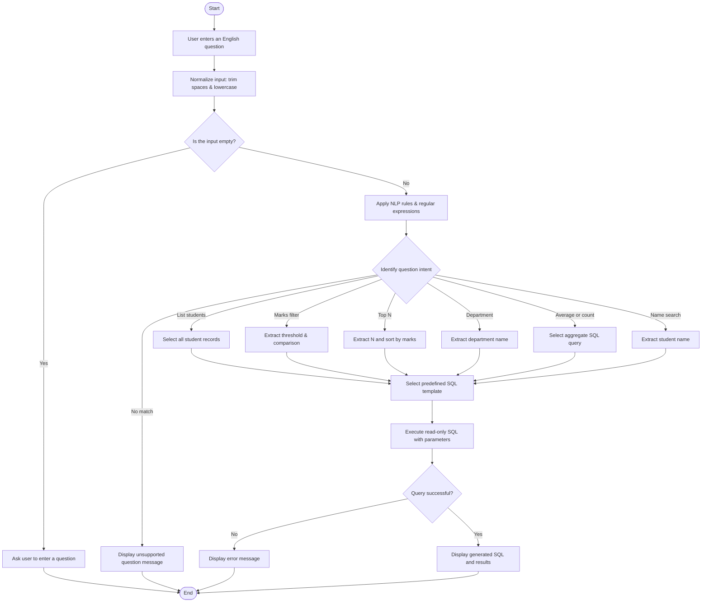

# DMAI Project: NLP for Database Interaction (Text-to-SQL)

## 1. Project Overview
This project implements an intelligent **Natural Language Processing (NLP) to SQL** interface designed for **DMAI (Data Mining & Artificial Intelligence)**.

The system translates English questions into parameterized, read-only SQL queries and executes them against a relational **SQLite** database containing student academic records. As specified in the project guidelines, it avoids heavy, resource-intensive large language models and instead implements a deterministic, lightweight **rule-based NLP and regular expressions system** (with optional NLTK support) following the official flowchart.

---

## 2. Architecture & Flowchart Implementation

The pipeline implements every decision node and action block from the provided system flowchart:



---

## 3. Supported Intents & Query Mapping

| Intent | Sample English Query | Extracted Entities | Generated Parameterized SQL |
| :--- | :--- | :--- | :--- |
| **List Students** | *"Show all students"* | `{}` | `SELECT id, name, department, marks, grade, email, city FROM students ORDER BY id ASC` |
| **Marks Filter** | *"Students with marks greater than 85"* | `operator: ">"`, `threshold: 85.0` | `SELECT id, name, department, marks, grade, email, city FROM students WHERE marks > ? ORDER BY marks DESC` |
| **Marks Filter (Below)** | *"Students who scored below 70"* | `operator: "<"`, `threshold: 70.0` | `SELECT id, name, department, marks, grade, email, city FROM students WHERE marks < ? ORDER BY marks DESC` |
| **Top N** | *"Who are the top 3 students"* | `n: 3` | `SELECT id, name, department, marks, grade, email, city FROM students ORDER BY marks DESC LIMIT ?` |
| **Department** | *"Students in Computer Science"* | `department: "Computer Science"` | `SELECT id, name, department, marks, grade, email, city FROM students WHERE LOWER(department) = LOWER(?) ORDER BY marks DESC` |
| **Average (Aggregate)** | *"What is the average marks of students"* | `aggregate: "AVG"` | `SELECT ROUND(AVG(marks), 2) AS average_marks FROM students` |
| **Count (Aggregate)** | *"How many students in Mechanical"* | `aggregate: "COUNT"`, `dept: "Mechanical"` | `SELECT COUNT(*) AS total_students FROM students WHERE LOWER(department) = LOWER(?)` |
| **Name Search** | *"Find student named Priya"* | `name: "priya"` | `SELECT id, name, department, marks, grade, email, city FROM students WHERE LOWER(name) LIKE LOWER(?)` |
| **Empty Input** | *""* | `empty: True` | *(Flowchart prompt to enter question)* |
| **No Match** | *"What is the capital of France"* | `None` | *(Displays unsupported question message)* |

---

## 4. Security & Read-Only Enforcement
To guard against SQL injection and unintended modifications:
1. **Parameterized Queries**: All user extracted variables (`threshold`, `department`, `name`, `limit`) are bound dynamically as SQL parameters (`?`), never concatenated as raw strings.
2. **Read-Only Validation**: Query validator verifies that every query starts strictly with `SELECT`. Destructive keywords (`DROP`, `DELETE`, `UPDATE`, `INSERT`, `ALTER`, `TRUNCATE`, `PRAGMA`) and multi-statement queries (semicolon injection) are rejected with a security violation.

---

## 5. Project Directory Structure
```
dmai_nlp_database/
├── database/
│   ├── schema.sql              # Students table schema (id, name, department, marks, grade, email, city)
│   ├── seed_data.py            # SQLite database seeding script
│   ├── table_manager.py        # Dynamic table creation, CSV import & schema inspection
│   └── students.db             # Pre-populated SQLite database (26 records + custom tables)
├── nlp_engine/
│   ├── __init__.py             # Unified parse_query() pipeline
│   ├── normalizer.py           # Trims spaces, lowercases, NLTK tokenization
│   ├── intent_classifier.py    # Rule-based & regex intent classifier with dynamic table routing
│   ├── entity_extractor.py     # Parameter & entity parsing (departments, names, numbers, tables)
│   └── sql_templates.py        # Safe SQL template generator
├── executor/
│   ├── __init__.py
│   └── query_executor.py       # Read-only validator and execution handler
├── ui/
│   ├── cli.py                  # Interactive terminal interface with ASCII tables
│   ├── web_app.py              # Zero-dependency browser web GUI with table studio endpoints
│   └── templates/
│       └── index.html          # Clean dashboard with sample buttons, glowing SQL centerpiece & table studio
├── tests/
│   ├── test_nlp_sql.py         # Comprehensive test suite covering all flowchart paths
│   └── test_flexible.py        # Natural language variation tests
├── demo.py                     # Automated demonstration runner for presentation/viva
├── main.py                     # Main application entry point
├── requirements.txt            # Package metadata (NLTK integration)
└── README.md                   # Full documentation
```

---

## 5. Custom Table Studio (Create & Query Your Own Tables)
The system supports dynamic schema extension without modifying any code:
1. **Live Schema Viewer**: Inspect all existing database tables, column names, data types, and row previews directly in the Web UI.
2. **Visual Table Builder**: Specify a custom table name (e.g. `books`, `projects`) and define column names and types (`INTEGER`, `TEXT`, `REAL`). The table is automatically registered in SQLite.
3. **CSV Data Import**: Paste raw CSV data or select quick presets (`courses`, `employees`, `books`) with instant schema inference and batch insertion.
4. **Instant Natural Language Querying**: The NLP engine inspects the live database catalog dynamically. Once a table like `courses` or `professors` is added, queries such as `"show all courses"` or `"show all professors"` automatically generate and execute valid SQL queries (`SELECT * FROM courses ORDER BY id ASC`).

---

## 6. How to Run

The project has **zero external dependencies** and runs directly on standard Python 3!

### Option A: Interactive Command Line (CLI)
```bash
python main.py
```
*Allows typing questions interactively. Type `samples` to view example questions or `exit` to quit.*

### Option B: Interactive Web Application
```bash
python main.py --web
```
*Opens a web interface at **`http://localhost:8000`** with one-click test buttons for each flowchart branch, intent badges, and live result tables.*

### Option C: Automated Demonstration (Ideal for Viva)
```bash
python main.py --demo
```
*Runs through all 11 flowchart scenarios sequentially, printing inputs, decisions, generated SQL, and result tables.*

### Option D: Direct Single Query Execution
```bash
python main.py -q "students with marks greater than 85"
```

### Option E: Run Automated Unit Tests
```bash
python -m unittest discover -s tests -p "test_*.py" -v
```

---

## 7. Key Talking Points for Viva & Submission
1. **Why Rule-Based NLP instead of heavy LLMs?**
   - High interpretability, 100% deterministic outputs, zero hallucination of invalid table/column names, and millisecond latency without requiring GPUs or paid API keys.
2. **How are Synonyms Handled?**
   - Departments are mapped through a canonical alias dictionary (e.g., `"cs"`, `"cse"`, `"comp sci"` all map to `"Computer Science"`).
3. **How is SQL Injection Prevented?**
   - Separation of query structure from parameters using SQLite parameter binding (`?`) combined with a strict AST/keyword read-only validator.
